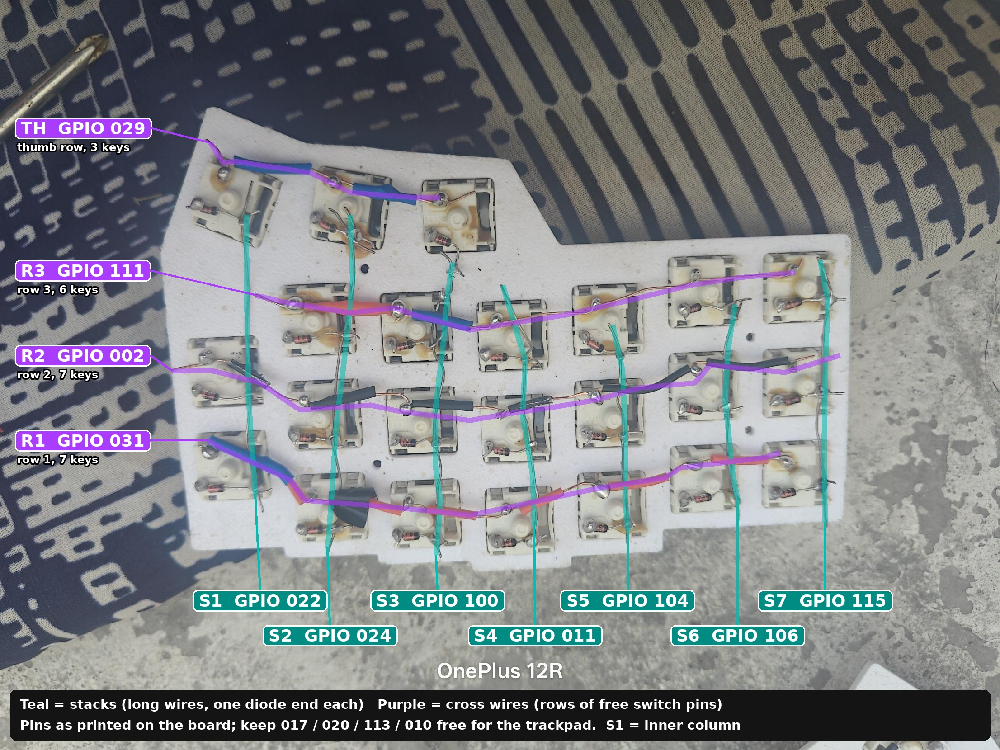
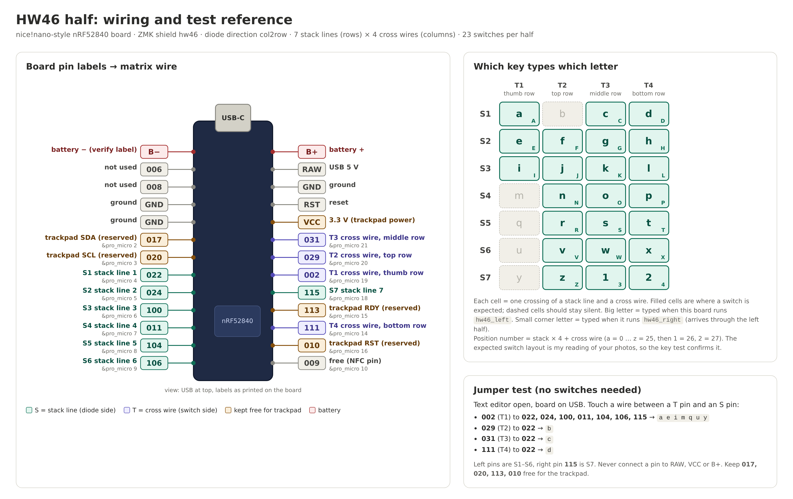
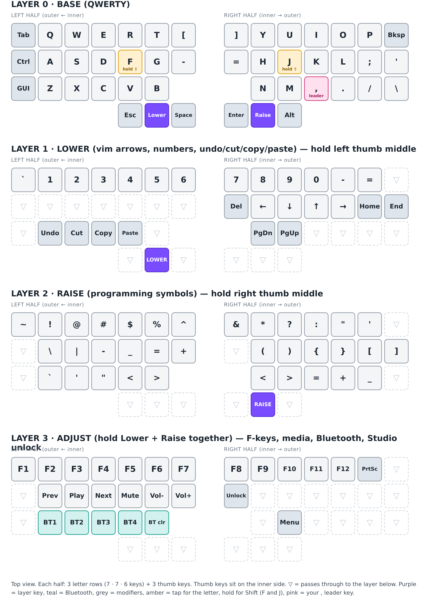
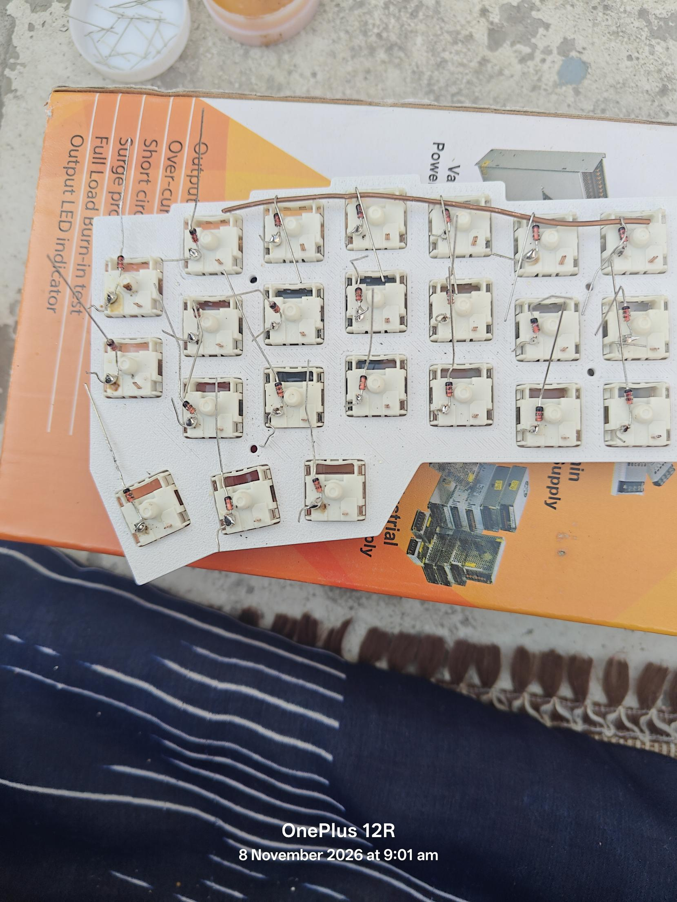
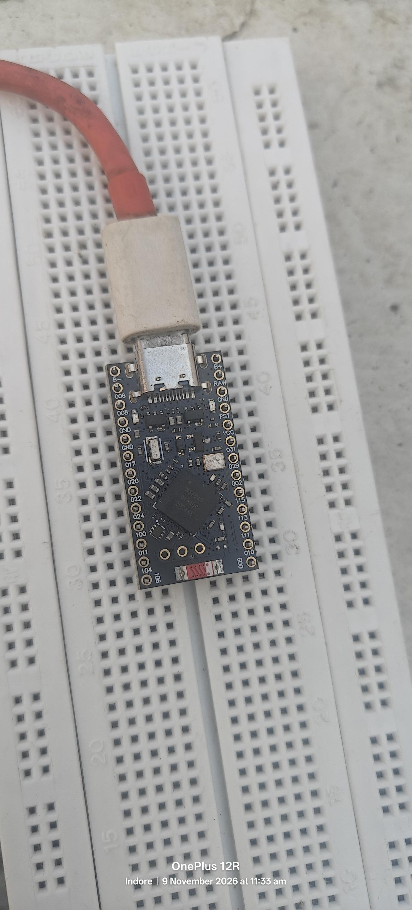
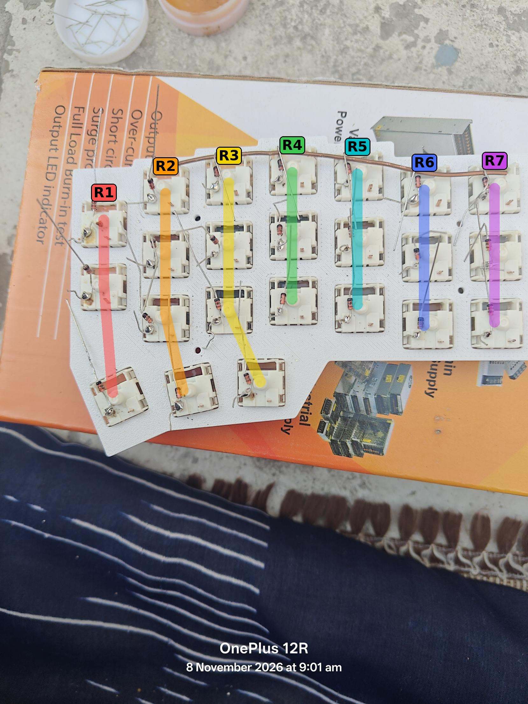

# HW46: handwired wireless split keyboard, build notes

Backup of everything worked out while building this keyboard (7 to 12 Nov 2026).
Each fact is marked **Verified** (tested on the real hardware), **Built** (compiled, not yet tested on the keyboard) or **Assumed** (reasoned from photos or datasheets, still to be confirmed).

> Print-ready wall reference: [`print/HW46-keymap-print.pdf`](print/HW46-keymap-print.pdf) (page 1 key map, page 2 wiring and quick steps).

---

## 1. Project at a glance

| Item | Value |
|---|---|
| Keyboard | Handwired split, wireless (Bluetooth between halves and to the PC) |
| Keys | 23 per half, 46 total (per half: rows of 7, 7 and 6 keys, plus 3 thumb keys) |
| Firmware | [ZMK](https://zmk.dev), shield name `hw46` (`hw46_left`, `hw46_right`) |
| MCU (x2) | nRF52840 "nice!nano"-style Pro Micro board, USB-C |
| Wiring | Diode matrix, `col2row`, 7 stack lines x 4 cross wires per half |
| Trackpad (later) | Azoteq TPS43, on the central half |
| Config repo | `yashdeeph709/hw46-zmk-firmware-config` (GitHub) |
| ZMK version in the repo | `v0.3` (pinned in `config/west.yml`) |
| Bluetooth names | left (central, the one the PC pairs with) = `HW46`; right (peripheral) = `HW46-R` |

### Status (12 Nov 2026)
- Both halves built, wired to the MCUs, and typing. All keys on the left half work. Both halves talk to each other and to the PC over Bluetooth. **Verified** (with the matrix test keymap)
- Pin map and key-to-pin mapping confirmed by the builder for both halves (section 5). **Verified**
- Real keymap (4 layers, vim-style Lower layer, F/J hold-Shift) and ZMK Studio support written, and all three firmware files compile: **Built**, not yet flashed.
- Not done yet: flash and test the real keymap, power switch, reset button, trackpad, case and spacers.

---

## 2. Parts and tools

- 2 x nRF52840 Pro Micro boards (nice!nano-compatible; see section 6 for the bootloader info).
- 46 switches, 3D-printed plates (one per half), keycaps.
- Diodes: 100 pcs glass **1N4148** (black band = cathode). The seller listing called them "1N4148 1W zener", which is wrong; the parts received are the small glass switching diodes. A real zener is **not used** anywhere.
- Bare single-strand copper wire (no jacket) for the stack lines and cross wires; thin jacketed wire for the runs to the MCU. Note: the thin grey wire used on some stacks may be steel, which solders poorly (see section 10).
- Battery: 3.7 V 500 mAh 1S LiPo, 902030 size, ~10 g, protection circuit (PCM) built in, **open wires, no connector**, soldered to the `B+` / `B-` pads.
- Azoteq **TPS43** trackpad (IQS572 controller, I2C, 3.3 V), to be added later.
- Soldering iron, solder, flux; multimeter with **no diode mode** (resistance on the 2000 Ω range is used instead).
- A 4-leg tactile switch for a reset button (planned) and a small slide switch for power (planned).
- No JST connector, and not ordering one (delays the build).

---

## 3. Design decisions

1. **Wireless split.** Each half has its own MCU and battery. The left half is the **central** (talks to the PC over USB or Bluetooth). The right half is the **peripheral** and sends key presses to the left half over Bluetooth.
2. **Matrix, not direct pin.** 23 keys per half would need 23 GPIOs for direct wiring. A matrix needs 7 + 4 = 11.
3. **Diode direction `col2row`.** Diode anode on the switch pin, cathode (banded end) toward the stack line. ZMK drives the cross wires and reads the stack lines.
4. **Both halves wired identically** (same pins, same row-to-pin assignment), so one shield file serves both. Only the firmware role differs.
5. **Trackpad on the central half**, powered from the board's `VCC` (3.3 V) pin, not a separate battery. Four GPIOs are kept free for it.
6. **Battery soldered directly** to `B+` / `B-`. A slide switch on the positive lead is planned (section 11).
7. **Keymap for a vim user who programs:** Esc on a thumb, hjkl arrows on a layer, `,` stays on its normal key as the leader, brackets on the home row of a symbols layer (section 7).
8. **Phase 1 is the bare keyboard; the trackpad is added later**, after measuring current draw.

---

## 4. The matrix

### Naming
ZMK's "rows" and "columns" are just the two sides of the matrix; they don't have to run in any physical direction. With `col2row`, the diode cathodes join the **rows**. To avoid confusion, these notes use:

- **S1 to S7 = "stacks"**: the 7 groups of switches that share one wire made from the joined diode cathodes. **S1 is the innermost column (next to the other half), S7 the outermost**, on both halves. In ZMK these are the **rows**.
- **Cross wires**: 4 wires running across the stacks, each on the free switch pin (the one without a diode). In ZMK these are the **columns**. They are named by the row of keys they serve: **Row 1** (top, 7 keys), **Row 2** (home row, 7 keys), **Row 3** (bottom, 6 keys) and **Thumb** (3 keys).

Every switch sits at one crossing of a stack and a cross wire. In earlier notes and in images 08 and 09 the cross wires are called T1 to T4 in **pin order**; their real rows are: T1 (`002`) = Row 2, T2 (`029`) = Thumb, T3 (`031`) = Row 1, T4 (`111`) = Row 3.

### Final key layout (seen from above)

| | Cross wire | Pin | Keys per half |
|---|---|---|---|
| Row 1 | top | `031` | 7 (S1 to S7) |
| Row 2 | home row | `002` | 7 (S1 to S7) |
| Row 3 | bottom | `111` | 6 (S2 to S7; the inner key S1 is missing) |
| Thumb | thumb row | `029` | 3 (S1 to S3, the inner three columns) |

Stack sizes: S1 = 3 keys (Row 1, Row 2, thumb), S2 = 4, S3 = 4, S4 to S7 = 3 each, so 23 per half.

### Diode wiring (per switch)
1. Solder the diode's **non-banded leg (anode)** to one pin of the switch (the same pin on every switch).
2. The **banded leg (cathode)** points away from the switch and is joined with the others in the same stack.
3. Join the stack's cathodes with bare copper; leave a 3 to 4 cm tail for the MCU wire.
4. Insulate (heat shrink or Kapton) wherever a cross wire crosses a stack line.
5. Cross wires go on the other pin of each switch, last.

Switches have **no polarity**; either pin can take the diode, as long as it is the same on all of them.

### How a key press works
The MCU drives one cross wire (column) high at a time and reads all 7 stack lines (rows). A press connects the driven wire through the switch and diode to a stack line, so the MCU knows both. Diodes stop current from leaking backwards through other pressed keys (ghosting).



---

## 5. Pin map (labels as printed on this board)

The board's silkscreen shows **GPIO names** (`022` = P0.22), not Arduino numbers.

| Matrix wire | Printed label | ZMK `&pro_micro` | Serves |
|---|---|---|---|
| S1 | `022` | 4 | stack, innermost column |
| S2 | `024` | 5 | stack |
| S3 | `100` | 6 | stack |
| S4 | `011` | 7 | stack |
| S5 | `104` | 8 | stack |
| S6 | `106` | 9 | stack |
| S7 | `115` | 18 | stack, outermost column |
| `002` | `002` | 19 | cross wire: Row 2 (home row), 7 keys |
| `029` | `029` | 20 | cross wire: Thumb row, 3 keys |
| `031` | `031` | 21 | cross wire: Row 1 (top), 7 keys |
| `111` | `111` | 14 | cross wire: Row 3 (bottom), 6 keys |

**Kept free for the trackpad (central half):** `017` (SDA, pro_micro 2), `020` (SCL, pro_micro 3), `113` (pro_micro 15, e.g. RDY), `010` (pro_micro 16, e.g. RST). Power from `VCC` (3.3 V) and `GND`.

**Not used:** `006` and `008` (the board's serial port can claim them), `009` (NFC pin).

**Full label order, USB at top (from the photo):**
- Left: `B-`(verify), `006`, `008`, GND, GND, `017`, `020`, `022`, `024`, `100`, `011`, `104`, `106`
- Right: `B+`, RAW, GND, RST, VCC, `031`, `029`, `002`, `115`, `113`, `111`, `010`, `009`

**Verified jumper tests (touch two pins, text editor open, board on USB, matrix test keymap):**

| Jumper | Typed |
|---|---|
| `002` to `022` | `a` |
| `029` to `022` | `b` |
| `031` to `022` | `c` |
| `111` to `022` | `d` |
| `002` to `024` | `e` |

(The first attempt used the wrong right-side mapping and typed `b` and `f`. That is how the reversed order was found.)

### Key-to-pin table (all 46 keys)
Position numbers are the order of the bindings on every layer. "Left" lists keys outer to inner, "Right" inner to outer.

| Pos | Key | Half | Row | Stack (pin) | Cross wire (pin) | `RC(row,col)` |
|---|---|---|---|---|---|---|
| 0 | `Tab` | Left | Row 1 (top) | S7 (`115`) | `031` | `RC(6,2)` |
| 1 | `Q` | Left | Row 1 (top) | S6 (`106`) | `031` | `RC(5,2)` |
| 2 | `W` | Left | Row 1 (top) | S5 (`104`) | `031` | `RC(4,2)` |
| 3 | `E` | Left | Row 1 (top) | S4 (`011`) | `031` | `RC(3,2)` |
| 4 | `R` | Left | Row 1 (top) | S3 (`100`) | `031` | `RC(2,2)` |
| 5 | `T` | Left | Row 1 (top) | S2 (`024`) | `031` | `RC(1,2)` |
| 6 | `[` | Left | Row 1 (top) | S1 (`022`) | `031` | `RC(0,2)` |
| 7 | `]` | Right | Row 1 (top) | S1 (`022`) | `031` | `RC(0,6)` |
| 8 | `Y` | Right | Row 1 (top) | S2 (`024`) | `031` | `RC(1,6)` |
| 9 | `U` | Right | Row 1 (top) | S3 (`100`) | `031` | `RC(2,6)` |
| 10 | `I` | Right | Row 1 (top) | S4 (`011`) | `031` | `RC(3,6)` |
| 11 | `O` | Right | Row 1 (top) | S5 (`104`) | `031` | `RC(4,6)` |
| 12 | `P` | Right | Row 1 (top) | S6 (`106`) | `031` | `RC(5,6)` |
| 13 | `Bksp` | Right | Row 1 (top) | S7 (`115`) | `031` | `RC(6,6)` |
| 14 | `Ctrl` | Left | Row 2 (home) | S7 (`115`) | `002` | `RC(6,0)` |
| 15 | `A` | Left | Row 2 (home) | S6 (`106`) | `002` | `RC(5,0)` |
| 16 | `S` | Left | Row 2 (home) | S5 (`104`) | `002` | `RC(4,0)` |
| 17 | `D` | Left | Row 2 (home) | S4 (`011`) | `002` | `RC(3,0)` |
| 18 | `F` | Left | Row 2 (home) | S3 (`100`) | `002` | `RC(2,0)` |
| 19 | `G` | Left | Row 2 (home) | S2 (`024`) | `002` | `RC(1,0)` |
| 20 | `-` | Left | Row 2 (home) | S1 (`022`) | `002` | `RC(0,0)` |
| 21 | `=` | Right | Row 2 (home) | S1 (`022`) | `002` | `RC(0,4)` |
| 22 | `H` | Right | Row 2 (home) | S2 (`024`) | `002` | `RC(1,4)` |
| 23 | `J` | Right | Row 2 (home) | S3 (`100`) | `002` | `RC(2,4)` |
| 24 | `K` | Right | Row 2 (home) | S4 (`011`) | `002` | `RC(3,4)` |
| 25 | `L` | Right | Row 2 (home) | S5 (`104`) | `002` | `RC(4,4)` |
| 26 | `;` | Right | Row 2 (home) | S6 (`106`) | `002` | `RC(5,4)` |
| 27 | `'` | Right | Row 2 (home) | S7 (`115`) | `002` | `RC(6,4)` |
| 28 | `GUI` | Left | Row 3 (bottom) | S7 (`115`) | `111` | `RC(6,3)` |
| 29 | `Z` | Left | Row 3 (bottom) | S6 (`106`) | `111` | `RC(5,3)` |
| 30 | `X` | Left | Row 3 (bottom) | S5 (`104`) | `111` | `RC(4,3)` |
| 31 | `C` | Left | Row 3 (bottom) | S4 (`011`) | `111` | `RC(3,3)` |
| 32 | `V` | Left | Row 3 (bottom) | S3 (`100`) | `111` | `RC(2,3)` |
| 33 | `B` | Left | Row 3 (bottom) | S2 (`024`) | `111` | `RC(1,3)` |
| 34 | `N` | Right | Row 3 (bottom) | S2 (`024`) | `111` | `RC(1,7)` |
| 35 | `M` | Right | Row 3 (bottom) | S3 (`100`) | `111` | `RC(2,7)` |
| 36 | `,` | Right | Row 3 (bottom) | S4 (`011`) | `111` | `RC(3,7)` |
| 37 | `.` | Right | Row 3 (bottom) | S5 (`104`) | `111` | `RC(4,7)` |
| 38 | `/` | Right | Row 3 (bottom) | S6 (`106`) | `111` | `RC(5,7)` |
| 39 | `\` | Right | Row 3 (bottom) | S7 (`115`) | `111` | `RC(6,7)` |
| 40 | `Esc` | Left | Thumb | S3 (`100`) | `029` | `RC(2,1)` |
| 41 | `Lower` | Left | Thumb | S2 (`024`) | `029` | `RC(1,1)` |
| 42 | `Space` | Left | Thumb | S1 (`022`) | `029` | `RC(0,1)` |
| 43 | `Enter` | Right | Thumb | S1 (`022`) | `029` | `RC(0,5)` |
| 44 | `Raise` | Right | Thumb | S2 (`024`) | `029` | `RC(1,5)` |
| 45 | `Alt` | Right | Thumb | S3 (`100`) | `029` | `RC(2,5)` |



---

## 6. Firmware

### Repo layout (`yashdeeph709/hw46-zmk-firmware-config`)
```
build.yaml
.github/workflows/build.yml
config/
  west.yml                      (ZMK pinned to v0.3)
  hw46.keymap                   (the real keymap: 4 layers, hold-tap Shift, Studio unlock)
  boards/shields/hw46/
    Kconfig.shield
    Kconfig.defconfig           (names: HW46 / HW46-R, central role on the left)
    hw46.dtsi                   (kscan, 46-key matrix transform, physical layout with key positions)
    hw46_left.overlay           (column pins; this half is the central)
    hw46_right.overlay          (column pins + col-offset = 4)
zephyr/module.yml
```

### `build.yaml`
```yaml
---
include:
  - board: nice_nano_v2
    shield: settings_reset
  - board: nice_nano_v2
    shield: hw46_left
    snippet: studio-rpc-usb-uart
    cmake-args: -DCONFIG_ZMK_STUDIO=y
  - board: nice_nano_v2
    shield: hw46_right
```
ZMK Studio is enabled on the **left (central) half only**.

**Build failure and fix:** the first build failed with `No board named 'nice_nano//zmk' found`. The repo is pinned to ZMK **v0.3**, which still uses the older board name `nice_nano_v2`. The newer `nice_nano//zmk` name belongs to later ZMK versions.

### Key settings in the shield
- `diode-direction = "col2row"`
- Rows (7, the stacks): pro_micro 4, 5, 6, 7, 8, 9, 18
- Columns (4, the cross wires): pro_micro 19, 20, 21, 14, which are pins `002`, `029`, `031`, `111`
- Matrix transform: `rows = <7>`, `columns = <8>` (left 0 to 3, right 4 to 7 through `col-offset = <4>`), with **46 entries**, one per real key, in reading order. This is also the order of every layer's bindings. The physical layout lists the same 46 keys with sizes and positions, which ZMK Studio needs.
- Left shield sets `ZMK_SPLIT_ROLE_CENTRAL`; names: `HW46` (left), `HW46-R` (right).

### Bootloader info (genuine nice!nano)
```
UF2 Bootloader 0.6.0 lib/nrfx (v2.0.0) lib/tinyusb (0.10.1-41-gdf0cda2d) lib/uf2 (remotes/origin/configupdate-9-gadbb8c7)
Model: nice!nano
Board-ID: nRF52840-nicenano
SoftDevice: S140 version 6.1.1
Date: Jun 19 2021
```
This matches the `nice_nano_v2` build target.

### The matrix test keymap (historical)
Used to prove the wiring: every crossing typed a unique character. Position = stack index x 4 + cross-wire index in pin order (`002`, `029`, `031`, `111`). Left firmware typed `a` to `z`, `1`, `2`; right firmware typed `A` to `Z`, `3`, `4`. For example `m` = stack S4 on `002`. It is no longer in the repo.

---

## 7. The keymap



- **Base:** QWERTY. Tab, Ctrl and GUI on the left edge; Backspace on the right edge. Brackets `[` `]` next to the top row, `-` and `=` next to the home row, `;` and `'` at the right end of the home row.
- **Thumbs:** left = `Esc`, `Lower` (hold), `Space`; right = `Enter`, `Raise` (hold), `Alt`.
- **Esc** is on the outer left thumb (fast, off the home row). **Ctrl** is on the left home-row pinky (for vim `Ctrl-w`, `Ctrl-d`, `Ctrl-u`, `Ctrl-r`).
- **Leader `,`** stays on its normal key (bottom row, right hand, third key from the inner edge).
- **F and J:** tap = the letter, hold = Shift. Each Shift only triggers when the next key is on the **other half** (opposite-hand rule), so there is no Shift on the outer edges. Hold F plus `;` gives `:` for vim command mode. Settings: `balanced`, 220 ms hold, 175 ms quick-tap, 150 ms prior-idle, hold-trigger-on-release. Tune these if capitals misfire.
- **Lower (vim layer):** `H J K L` become the arrow keys `Left Down Up Right`; `Home`, `End` on `;` `'`; `PgDn`, `PgUp` on `N`, `M`; `Del` on the key left of `H`. Numbers and `` ` `` on the top row of the left half. `Z X C V` become `Ctrl+Z` (undo), `Shift+Del` (cut), `Ctrl+Ins` (copy), `Shift+Ins` (paste), which work in terminals and in vim.
- **Raise (programming symbols):** `( ) { } [ ]` on the right home row; `~ ! @ # $ % ^` and `& * ? : " '` on the top rows; operators `\ | - _ = +` and `< > =` on the others. A few symbols are repeated on purpose and can be changed.
- **Adjust** (hold Lower and Raise together, a conditional layer): F1 to F12, Print Screen, media keys, Bluetooth profiles 1 to 4 and clear, the Menu key, and the **`&studio_unlock`** key (first key of the right half's home row).
- **Two spare layers** are reserved for ZMK Studio.

### ZMK Studio (live remapping)
- Lets you change which behavior is on each key from a web app over USB, with no rebuild and no reflash. See the [ZMK Studio docs](https://zmk.dev/docs/features/studio).
- Can assign existing behaviors, rename layers and use the reserved layers. **Cannot** define new behaviors (the F/J hold-tap and the layers come from the file), combos or conditional layers.
- Once Studio manages the keymap, later edits to `hw46.keymap` are **ignored** until "Restore Stock Settings" is used in Studio.
- Needs the `studio-rpc-usb-uart` snippet and `CONFIG_ZMK_STUDIO=y` on the left half only, a `&studio_unlock` key, and a physical layout with a `keys` list. All three are in the repo files.
- The firmware compiles with Studio on (built with the ZMK v0.3 sources); the Studio app itself is **not yet tested** on this keyboard.

---

## 8. Flashing, pairing and changing the keymap

### Getting the firmware
Push to GitHub, open **Actions**, open the latest green run, download the `firmware` zip. It holds `settings_reset`, `hw46_left` and `hw46_right` as `.uf2` files.

### Entering the bootloader
1. Plug in with a **data** USB cable, straight into the PC (no hub).
2. **Double-tap reset quickly** (two taps in about half a second). The blue LED should pulse slowly and a USB drive called `NICENANO` appears.
3. A steady blue LED with no drive means the board is running firmware, not the bootloader. Try the double-tap again, faster. If the reset button is hidden in the case, touch a wire from `RST` to `GND` twice.
4. Copy the `.uf2` onto the drive. The drive disappears by itself when the copy finishes. **Windows may show a "try again" error at that moment; that is normal and the flash worked.**

### Routine: change the keymap
1. Edit `config/hw46.keymap` (or use Studio, once enabled).
2. Push, wait for the build, download the zip.
3. Flash **only `hw46_left`** onto the left half. The right half does not need flashing for keymap changes, and `settings_reset` is not needed; Bluetooth pairings survive.
4. Changes to the matrix transform, pins or right-half config need **both** halves reflashed.

### Fresh start or pairing trouble
1. Flash `settings_reset` on **both** boards (one at a time). The boards then do nothing visible until the real firmware is flashed.
2. Flash `hw46_left` on the left board and `hw46_right` on the right board. Each board must have its own firmware: a right board left on `hw46_left` types by itself and never joins the left half.
3. On the PC, **remove "HW46"** from the Bluetooth list, tap reset on both boards, then add `HW46` again. Ignore `HW46-R`.
4. The right half connects to the left on its own within about 10 seconds. Test its keys (they type through the left half).

### Things to know
- **USB beats Bluetooth.** With a USB cable to a PC, the left half types over USB. On a plain charger it must use Bluetooth. "Works on the laptop but not on the charger" means the Bluetooth link or pairing is the problem, not power.
- **nRF Connect** (phone app) scan: a half that is powered but not connected to its partner advertises as `HW46` or `HW46-R`; a connected peripheral stops advertising, and a connected central stops advertising to the PC. Compare MAC addresses if two entries confuse you.
- **USB logging** for debugging: add `CONFIG_ZMK_USB_LOGGING=y` to a `config/hw46_left.conf` (or right), flash, open the new COM port in a serial terminal at 115200. Remove it afterwards (it uses power).
- **Standalone test:** flash `hw46_left` onto a half to see whether its matrix works on its own. If it does, the fault is the link between the halves.
- **Which board is which:** the left (central) board is the one the PC pairs with. The central should be the half that carries the trackpad; the roles can be swapped by reflashing.

---

## 9. Test results so far

| Test | Result |
|---|---|
| `INFO_UF2.TXT` on both bootloaders | genuine nice!nano info |
| `HW46` visible in Bluetooth | yes |
| Jumper tests `a b c d e` on the central board | pass |
| Peripheral board: jumper `002` to `022` | typed `A` on the PC (pairing works) |
| All keys on the left half (matrix test firmware) | pass after fixes below |
| Both halves, keys through Bluetooth | pass after the re-pair below |
| Diodes (1N4148) in resistance mode | a value one way, OL the other = good (about 640 to 850 Ω reads are normal on the 2000 Ω range) |
| Real keymap and Studio | compiled; not yet flashed |

### Problems met and how they were solved
| Problem | Cause and fix |
|---|---|
| Every key on stack S1 dead | The S1 wire was loose at the MCU pin. Reflowed it. A continuity test between the MCU pad and the stack wire (about 0 Ω) finds this. |
| A jumper between `S7` and the thumb cross wire gave nothing (`z` missing) | No key exists there; the matrix has no thumb key on S7. Not a fault. |
| One thumb key dead while the others on its stack and row worked | Bridging the stack and cross wire typed, bridging the switch pins did not: the diode path was open (a bad joint). The meter readings on that diode were also inconsistent, so check the probes touch each other at 0 Ω first, then reflow both diode joints. |
| Right half silent after assembly (it worked before) | The right board still ran `hw46_left` from the standalone test, so it never joined the left half. Fix: `settings_reset` on both, then `hw46_right` on the right board, and re-pair. |
| Left half worked on USB but not on a charger | Not the battery. Stale Bluetooth pairing after reflashing. Removed `HW46` from the PC and paired again. |
| No USB drive when copying | The board was running firmware (steady blue LED), not in the bootloader. Quicker double-tap, data cable, direct port. |
| "Try again" error while copying the `.uf2` | Normal: the drive vanishes as the board reboots into the new firmware. |
| Battery showed 27 % and it seemed to stop typing | 27 % is about 3.65 V, plenty. The real cause was Bluetooth (above). |

---

## 10. Soldering notes and lessons

- **Solder running off the pin:** the joint isn't hot enough, or the pin is dirty. Add flux; heat the pin and leg together for 1 to 2 s; touch solder to the joint, not the iron tip; use a tiny amount; about 330 to 350 °C.
- **Copper wire joints:** wrap the diode leg once around the wire first, add flux, heat wire and leg together 3 to 4 s, feed solder onto the joint. Tape the wire down so it can't move. A joint that tugs loose with tweezers must be reflowed.
- **Thin grey wire** on some stacks looks like steel and takes solder poorly; give each joint a pull test, and replace a stack with copper if a joint won't hold.
- **MCU joints:** tug every wire after soldering. A loose joint kills a whole stack or row, not one key.
- **Plate looks 3D printed (assumed PLA, which softens around 60 °C):** keep each joint to about 3 s and let it cool between joints.
- **Brown residue** around pins = burnt flux; harmless.
- **Insulate every crossing** of a cross wire over a stack line; bare copper will short.
- **Test between stages:** after the stack lines, check that no two stack lines touch (all OL); after the cross wires, check every stack against every cross wire (all OL, nothing pressed).
- **Rework:** power off or unplug USB and the battery, and don't bridge pins with the iron or tweezers while the board is live.
- The board's holes are bare (no headers): solder jacketed wire straight into the hole, board **unplugged from USB** while soldering; check each pin against its neighbours for bridges.
- Strain-relieve the wires near the MCU with a dot of hot glue.

Photos: 03, 04, 05, 06.



---

## 11. Battery, power and charging

### Charging
- The board charges the battery from USB at roughly **100 mA** (typical nice!nano). From 27 % that is about 3.5 to 4.5 hours; from empty about 5 to 6 hours. The red LED shows charging and goes off when full. **Assumed**; clone boards can differ.
- A **180 W phone brick is fine**: the board only gets 5 V and its own charger limits the current. A bigger brick does not charge faster. Use a data cable if you also want to flash.
- Faster charging would mean changing the charge-current resistor on the board (or an external charger). Not worth it for a battery that lasts weeks.
- Charge on a hard surface and don't leave a first charge unattended; stop using a puffy or hot battery.

### Battery life (estimates, not measured)
Usable capacity is about 400 mAh, so hours = 400 / average mA.

| Case | Average draw | Runtime |
|---|---|---|
| Deep sleep (ZMK sleeps after about 15 min idle) | 0.02 to 0.1 mA | months |
| Connected, idle | 0.5 to 1 mA | 2 to 5 weeks |
| Typing (peripheral) | 1 to 2 mA | 1.5 to 3 weeks |
| Central half | 1 to 3 mA | 1 to 3 weeks |
| Central with trackpad moving | 3 to 5 mA or more | 4 to 7 days |

An always-on power LED on the board can add 1 to 2 mA. To measure: unplug USB, put the meter on mA in series with the `B+` lead and read idle, typing and after 15 minutes idle.

### Power switch (planned)
The board has no power switch, so it is on whenever the battery is connected. Plan: cut the battery's **red (+) lead**, solder a small slide switch into the gap (heat-shrink the joints), leave the black lead alone. With the switch off the battery is disconnected, so it also **stops charging**; leave it on while charging. Do one lead at a time and keep bare ends from touching.

### Reset button (planned)
A 4-leg tactile switch between `RST` and `GND` (they are neighbours in the right-hand column: `RAW`, `GND`, `RST`, `VCC`). Find the pairs first: two legs on the same side read about 0 Ω all the time; opposite sides read OL until pressed. Take **one leg from each pair**; wiring both legs of one pair holds the board in reset permanently. One press restarts; two quick presses enter the bootloader.

### Battery checks
- Verified earlier: polarity checked with the meter and 3.7 V present before connecting.
- Battery percentage shows in the PC's Bluetooth device info (about 3.65 V is 27 %).

---

## 12. Trackpad, Azoteq TPS43 (Assumed; verify the pinout and driver before wiring)

- I2C at 3.3 V; needs SDA, SCL, RDY (data ready), RST, plus power.
- Reserved pins: `017` (SDA), `020` (SCL), `113`, `010`; power from `VCC` and `GND`.
- Driver: a community Azoteq IQS5xx module (`zmk-driver-azoteq-iqs5xx` was the one named earlier). Check that it still exists and supports the TPS43 before adding it to `west.yml`; ZMK may also have built-in support by now.
- Trackpad on the **central** half.
- Phase 2: measure the average current with and without the trackpad (multimeter in series on the mA range), and estimate runtime as roughly 400 mAh / average current. If too short: add a trackpad on/off switch, lower its report rate, or use a bigger battery on the central half.

---

## 13. Mechanical (case and spacers)

- Postponed until the electronics were finished. The switch plate needs to be fixed above the bottom plate with a gap for the MCU and battery (the battery is about 9 mm thick, and the plate pressed on it when forced into the case).
- Options: standoffs/spacers, or regular bolts with nuts and washers as spacers. Measure first: the gap needed, the hole diameter, and the case depth. Order online.
- Make sure no spacer, bolt or case edge presses on the battery, the MCU, or the matrix wires.

---

## 14. Next steps

1. Push the new files (`build.yaml`, `config/hw46.keymap`, `hw46.dtsi`, `Kconfig.defconfig`), let GitHub build, flash both halves, test every key on both layers.
2. Tune the F/J hold-Shift timing, and clean up duplicate symbols on Raise.
3. Try ZMK Studio.
4. Fit the power switch and the reset button.
5. Charge both halves fully, measure idle current on each.
6. Trackpad: wire, add the driver, test, measure current.
7. Spacers and case, strain relief, keycaps.
8. Print the wall reference (`print/HW46-keymap-print.pdf`).

---

## 15. Troubleshooting quick reference

| Symptom | Likely cause / fix |
|---|---|
| No USB drive when double-tapping reset | Steady blue LED = firmware running, not the bootloader. Quicker double-tap; data cable; direct port; check the USB connector joints |
| "Try again" when copying the `.uf2` | Normal; the drive vanishes as the board reboots |
| Build says `No board named ...` | Board name doesn't match the pinned ZMK version (`nice_nano_v2` for v0.3) |
| Right half types nothing | Right board must run `hw46_right` and pair to the left half; `settings_reset` on both, then re-pair |
| Right half types by itself (lowercase letters) | It is running `hw46_left`; flash `hw46_right` |
| Keys type over USB but not on a charger | Bluetooth pairing: remove `HW46` from the PC and pair again |
| Two "HW46" in the Bluetooth list | One is the right half before it bonded; pair only the one that types, or use the `HW46-R` name |
| Whole stack or row of keys dead | Loose wire at the MCU pin or a bad stack joint; continuity test from the pad to the wire |
| One key dead, the rest fine | Bad diode joint or the switch: bridge the switch pins, then the wires; reflow the diode joints |
| A key types a wrong letter or the wrong character | Wire on a different pin than the table in section 5; check the key-to-pin table |
| A key types constantly or two keys fire together | A short between a stack line and a cross wire, or two lines touching |
| Capitals misfire while typing fast | Raise `tapping-term-ms` on the F/J hold-tap, or keep the opposite-hand rule |
| Keyboard dies when USB is unplugged | Check battery voltage at the pads and the lead/joint resistance; check Bluetooth pairing first |
| Battery hot or puffy | Disconnect and stop using it |

---

## 16. Image index

| File | What it shows |
|---|---|
| `images/01-diode-listing-1n4148.jpg` | Glass diode from the seller listing (confirms it is a 1N4148) |
| `images/02-plate-with-test-wires.jpg` | Plate with switches seated and test wires laid out |
| `images/03-switch-pins-closeup.jpg` | Switch pins close-up before soldering |
| `images/04-diodes-soldered-to-switches.jpg` | First diodes soldered, long legs still on |
| `images/05-diodes-soldered-with-thumbs.jpg` | All diodes soldered, thumb keys included |
| `images/06-copper-wire-joints.jpg` | Copper wire along a stack, balled joints |
| `images/07-mcu-board-labels.jpg` | The MCU board, pin labels as printed |
| `images/08-stack-lines-highlighted.jpg` | Highlighted stack groups (old annotation; labels there say R1 to R7, which are S1 to S7 here) |
| `images/09-wiring-reference.png` | Pinout, matrix wires, test letter grid and jumper tests (cross wires are named T1 to T4 in pin order; see section 4 for their real rows) |
| `images/10-right-half-pins.jpg` | Right half seen from the wiring side, stacks and cross wires with pins (current) |
| `images/11-keymap-layers.png` | All four keymap layers |
| `print/HW46-keymap-print.pdf` | Print-ready key map and wiring reference |



