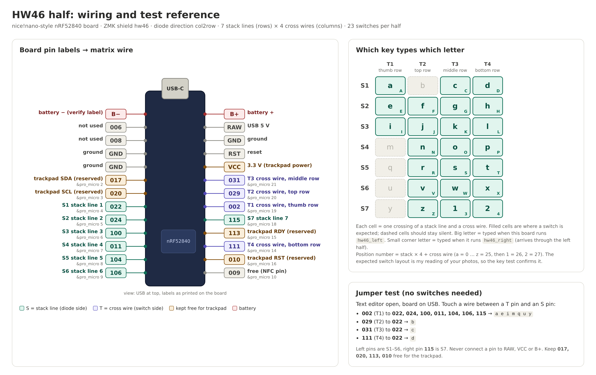
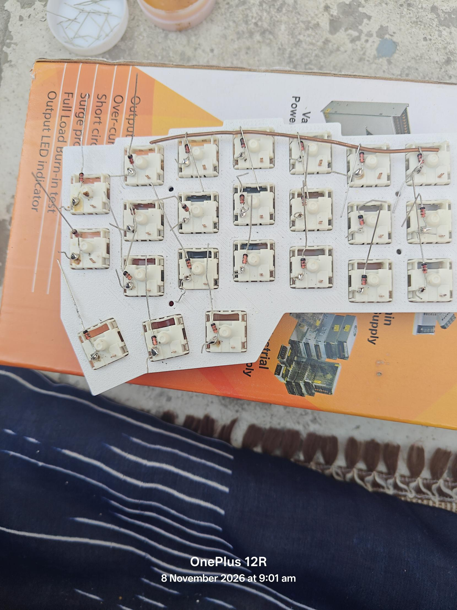
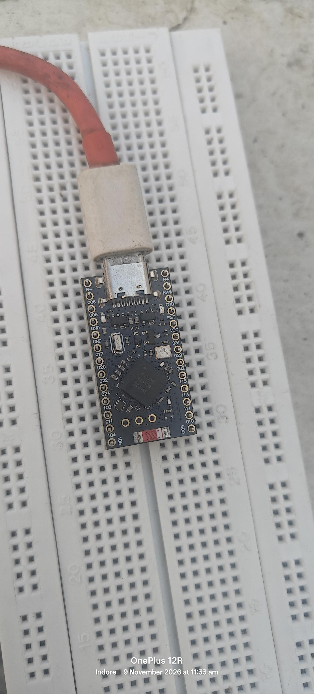
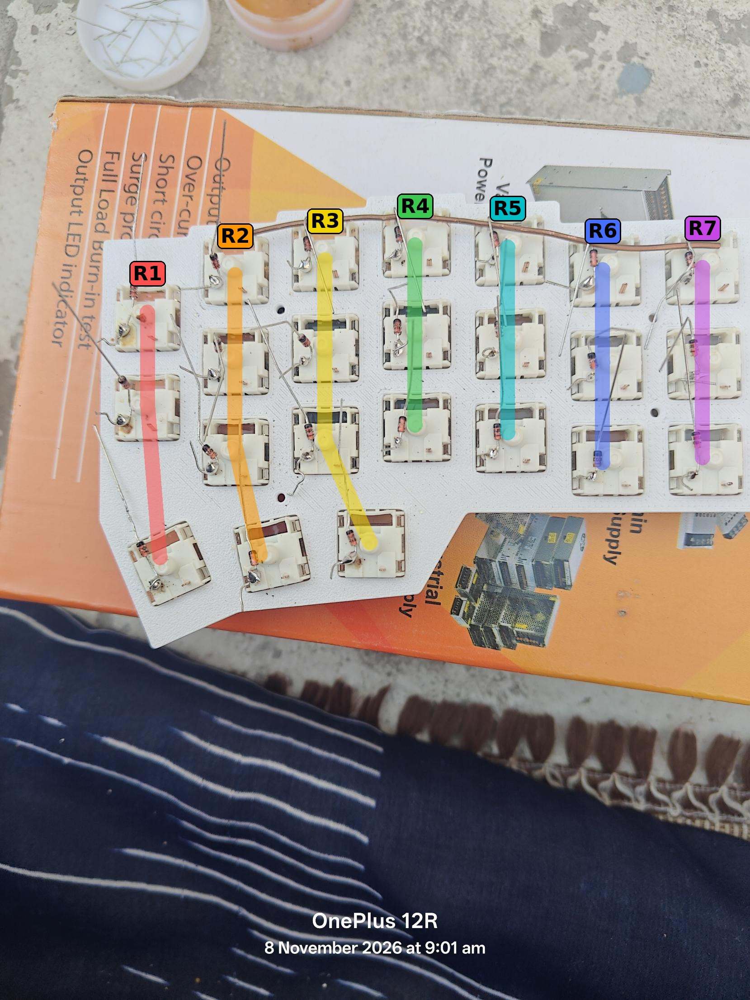

# HW46: handwired wireless split keyboard, build notes
Backup of everything worked out while building this keyboard (7–9 Nov 2026).
Each fact is marked **Verified** (tested on the real hardware) or **Assumed** (reasoned from photos or datasheets, still to be confirmed).

---

## 1. Project at a glance

| Item | Value |
|---|---|
| Keyboard | Handwired split, wireless (Bluetooth between halves and to the PC) |
| Keys | 23 per half, 46 total |
| Firmware | [ZMK](https://zmk.dev), shield name `hw46` (`hw46_left`, `hw46_right`) |
| MCU (x2) | nRF52840 "nice!nano"-style Pro Micro board, USB-C |
| Wiring | Diode matrix, `col2row`, 7 stack lines x 4 cross wires per half |
| Trackpad (later) | Azoteq TPS43, on the central half |
| Config repo | `yashdeeph709/hw46-zmk-firmware-config` (GitHub) |
| ZMK version in the repo | `v0.3` (pinned in `config/west.yml`) |

### Status (9 Nov 2026, ~12:20)
- Both boards flash, boot, and advertise over Bluetooth. **Verified**
- Both halves pair with each other (right board key arrived through the left board). **Verified**
- Pin map confirmed with jumpers. **Verified**
- Diodes soldered to all switches; matrix built and tested alone with the multimeter (reported by the builder).
- Matrix wires to the MCU and the full key test: **in progress** (testing one half).
- Real keymap, trackpad, and battery: **not started**.

---

## 2. Parts and tools

- 2 x nRF52840 Pro Micro boards (nice!nano-compatible; see §6 for the bootloader info).
- 46 switches, 3D-printed plates (one per half), keycaps.
- Diodes: 100 pcs glass **1N4148** (black band = cathode). The seller listing called them "1N4148 1W zener", which is wrong; the parts received are the small glass switching diodes. A real zener (1N47xx) is **not used** anywhere.
- Bare single-strand copper wire (no jacket) for the stack lines and cross wires; thin jacketed wire for the runs to the MCU.
- Battery: 3.7 V 500 mAh 1S LiPo, 902030 size, ~10 g, protection circuit (PCM) built in, **open wires, no connector**.
- Azoteq **TPS43** trackpad (IQS572 controller, I2C, 3.3 V), to be added later.
- Soldering iron, solder, flux; multimeter with **no diode mode** (resistance on the 2000 Ω range is used instead).
- No JST connector, and not ordering one (delays the build).

---

## 3. Design decisions

1. **Wireless split.** Each half has its own MCU and battery. The left half is the **central** (talks to the PC over USB or Bluetooth). The right half is the **peripheral** and sends key presses to the left half over Bluetooth.
2. **Matrix, not direct pin.** 23 keys per half would need 23 GPIOs for direct wiring. A matrix needs 7 + 4 = 11.
3. **Diode direction `col2row`.** Diode anode on the switch pin, cathode (banded end) toward the stack line. ZMK drives the cross wires and reads the stack lines.
4. **Both halves wired identically** (same pins), so one shield file serves both. Only the firmware role differs.
5. **Trackpad on the central half**, powered from the board's `VCC` (3.3 V) pin, not a separate battery. Four GPIOs are kept free for it.
6. **Battery connected last**, after keys and firmware are verified on USB. Soldered straight to the `B+` / `B-` pads (no JST).
7. **Phase 1 is the bare keyboard; the trackpad is added later**, after measuring current draw.

---

## 4. The matrix

### Naming (confusing, so pinned down here)
ZMK's "rows" and "columns" are just the two sides of the matrix; they don't have to run in any physical direction. With `col2row`, the diode cathodes join the **rows**. To avoid confusion, these notes use:

- **S1 to S7 = "stacks"**: the 7 vertical groups of switches in the photos, counted left to right. The cathode ends of a stack's diodes are joined into one **stack line**. In ZMK these are the **rows**.
- **T1 to T4 = "cross wires"**: 4 wires running across the stacks, each on the free switch pin (the one without a diode). In ZMK these are the **columns**.

Every switch sits at one crossing of a stack and a cross wire, e.g. the right thumb key is S3 / T1.

### Cross wires (rows of keys across the board)
| Wire | Meaning |
|---|---|
| T1 | thumb row |
| T2 | top row |
| T3 | middle row |
| T4 | bottom row |

### Expected switch positions (Assumed, from photos; confirm with the key test)
```
            T1(thumb) T2(top) T3(mid) T4(bottom)
S1             X        .       X        X
S2             X        X       X        X
S3             X        X       X        X
S4             .        X       X        X
S5             .        X       X        X
S6             .        X       X        X
S7             .        X       X        X
```
Counts: T1 = 3 (S1..S3), T2 = 6 (S2..S7), T3 = 7, T4 = 7 → **23 switches**.

Note (S1): it has the left thumb key (T1) plus 2 main-row keys, 3 in total. Which two cross wires those main-row keys use is assumed (T3 and T4 in the table); the key test will confirm. Stack sizes: S1 = 3, S2 = 4, S3 = 4, S4 to S7 = 3 each.

### Diode wiring (per switch)
1. Solder the diode's **non-banded leg (anode)** to one pin of the switch (the same pin on every switch).
2. The **banded leg (cathode)** points away from the switch and is joined with the others in the same stack.
3. Join the stack's cathodes with bare copper; leave a 3–4 cm tail for the MCU wire.
4. Insulate (heat shrink or Kapton) wherever a cross wire crosses a stack line.
5. Cross wires go on the other pin of each switch, last.

Switches have **no polarity**; either pin can take the diode, as long as it is the same on all of them.

### How a key press works
The MCU drives one cross wire (column) high at a time and reads all 7 stack lines (rows). A press connects the driven wire through the switch and diode to a stack line, so the MCU knows both. Diodes stop current from leaking backwards through other pressed keys (ghosting).

---

## 5. Pin map (labels as printed on this board)

The board's silkscreen shows **GPIO names** (`022` = P0.22), not Arduino numbers. The right-hand column order is reversed compared to what I first assumed (corrected after the first jumper test). See image 07 and image 09.

| Matrix wire | Printed label | ZMK `&pro_micro` | Side |
|---|---|---|---|
| S1 | `022` | 4 | left |
| S2 | `024` | 5 | left |
| S3 | `100` | 6 | left |
| S4 | `011` | 7 | left |
| S5 | `104` | 8 | left |
| S6 | `106` | 9 | left |
| S7 | `115` | 18 | right |
| T1 | `002` | 19 | right |
| T2 | `029` | 20 | right |
| T3 | `031` | 21 | right |
| T4 | `111` | 14 | right |

**Kept free for the trackpad (central half):** `017` (SDA, pro_micro 2), `020` (SCL, pro_micro 3), `113` (pro_micro 15, e.g. RDY), `010` (pro_micro 16, e.g. RST). Power from `VCC` (3.3 V) and `GND`.

**Not used:** `006` and `008` (the board's serial port can claim them), `009` (NFC pin).

**Full label order, USB at top (from the photo):**
- Left: `B-`(verify), `006`, `008`, GND, GND, `017`, `020`, `022`, `024`, `100`, `011`, `104`, `106`
- Right: `B+`, RAW, GND, RST, VCC, `031`, `029`, `002`, `115`, `113`, `111`, `010`, `009`

**Verified jumper tests (touch two pins, text editor open, board on USB):**

| Jumper | Typed |
|---|---|
| `002` to `022` | `a` |
| `029` to `022` | `b` |
| `031` to `022` | `c` |
| `111` to `022` | `d` |
| `002` to `024` | `e` |

(The first attempt used the wrong right-side mapping and typed `b` and `f`. That is how the reversed order was found.)

---

## 6. Firmware

### Repo layout (`yashdeeph709/hw46-zmk-firmware-config`)
```
build.yaml
.github/workflows/build.yml
config/
  west.yml                      (ZMK pinned to v0.3)
  hw46.keymap                   (matrix TEST keymap)
  boards/shields/hw46/
    Kconfig.shield
    Kconfig.defconfig
    hw46.dtsi                   (kscan, matrix transform, physical layout)
    hw46_left.overlay           (column pins; this half is the central)
    hw46_right.overlay          (column pins + col-offset = 4)
zephyr/module.yml
```

### `build.yaml`
```yaml
---
include:
  - board: nice_nano_v2
    shield: settings_reset
  - board: nice_nano_v2
    shield: hw46_left
  - board: nice_nano_v2
    shield: hw46_right
```

**Build failure and fix:** the first build failed with `No board named 'nice_nano//zmk' found`. The repo is pinned to ZMK **v0.3**, which still uses the older board name `nice_nano_v2`. The newer `nice_nano//zmk` name belongs to later ZMK versions. Switching to `nice_nano_v2` fixed it.

### Key settings in the shield
- `diode-direction = "col2row"`
- Rows (7): pro_micro 4, 5, 6, 7, 8, 9, 18
- Columns (4): pro_micro 19, 20, 21, 14
- Matrix transform: `rows = <7>`, `columns = <8>` (left 0–3, right 4–7 through `col-offset = <4>`)
- Left shield sets `ZMK_SPLIT_ROLE_CENTRAL`; keyboard name `HW46` (Bluetooth name).

### The test keymap
Every crossing prints a unique character so the wiring can be decoded:

- Position number = **stack index x 4 + cross wire index** (S1 = 0, T1 = 0).
- **Left firmware:** `a`…`z` = 0…25, then `1` = 26, `2` = 27.
- **Right firmware:** same grid, typed as uppercase `A`…`Z`, then `3`, `4`.
- Example: `m` = 12 → S4 on T1.

The same letter appears on both halves, as lowercase vs uppercase, so the halves can be told apart. This is for testing only; the real keymap will have a real key at each position.



### Bootloader info (genuine nice!nano)
```
UF2 Bootloader 0.6.0 lib/nrfx (v2.0.0) lib/tinyusb (0.10.1-41-gdf0cda2d) lib/uf2 (remotes/origin/configupdate-9-gadbb8c7)
Model: nice!nano
Board-ID: nRF52840-nicenano
SoftDevice: S140 version 6.1.1
Date: Jun 19 2021
```
This matches the `nice_nano_v2` build target.

### Flashing procedure
1. Plug in with a **data** USB cable. Double-tap the reset button; a USB drive appears.
2. Copy the `.uf2` file onto the drive. The drive disappears by itself (normal).
3. Order for a fresh start: `settings_reset` on both boards → then `hw46_left` on the central board and `hw46_right` on the peripheral board.
4. If the halves won't pair, flash `settings_reset` on **both**, then the real firmware on both.

Build and download: push to GitHub → **Actions** tab → open the latest green run → download the `firmware` zip → files `settings_reset`, `hw46_left`, `hw46_right` (`.uf2`).

Windows initially showed no drive; it appeared later (cause not confirmed; a charge-only cable or port was the main suspect). Windows listed no board in `Get-PnpDevice` at that time.

### Which board is which (current testing state)
- Board A (the one with the finished matrix, physically the "right half") is flashed with **`hw46_left`**, so it can type on its own over USB/Bluetooth for matrix testing.
- Board B is flashed with **`hw46_right`** and connects to board A.
- The permanent roles are decided later: the **central** board should be the half that carries the trackpad. Roles can be swapped any time by reflashing; the wiring is the same on both.

---

## 7. Test results so far

| Test | Result |
|---|---|
| `INFO_UF2.TXT` on both bootloaders | genuine nice!nano info |
| HW46 visible in Bluetooth | yes |
| Jumper tests `a b c d e` on the central board | pass |
| Peripheral board: jumper `002` to `022` | typed `A` on the PC (pairing works) |
| Diodes (1N4148) in resistance mode | a value one way, OL the other = good; readings ~850 on the 2000 Ω range were fine |
| Switch continuity | tested before soldering |

---

## 8. Soldering notes and lessons

- **Solder running off the pin:** the joint isn't hot enough, or the pin is dirty. Add flux; heat the pin and leg together for 1–2 s; touch solder to the joint, not the iron tip; use a tiny amount; ~330–350 °C.
- **Copper wire joints:** wrap the diode leg once around the wire first, add flux, heat wire and leg together 3–4 s, feed solder onto the joint. Tape the wire down so it can't move. A joint that tugs loose with tweezers must be reflowed.
- **Plate looks 3D printed (assumed PLA, which softens around 60 °C):** keep each joint to ~3 s and let it cool between joints.
- **Brown residue** around pins = burnt flux; harmless.
- **Insulate every crossing** of a cross wire over a stack line; bare copper will short.
- **Test between stages:** after the stack lines, check that no two stack lines touch (all OL); after the cross wires, check every stack against every cross wire (all OL, nothing pressed).
- A whiteboard marker is fine for labelling the boards (keep it off pads you'll solder).
- The board's holes are bare (no headers): solder jacketed wire straight into the hole, board **unplugged from USB** while soldering; check each pin against its neighbours for bridges.

Photos: 03, 04, 05, 06.



---

## 9. Battery and trackpad plans (not done yet)

### Battery (Assumed, not tested)
- 500 mAh 1S LiPo with PCM; charge limit 0.5C = 250 mA, which is fine with the board's charger.
- Check polarity with a multimeter against the board's `B+` / `B-` markings (the `B-` label is hard to read in photo 07; verify it) before connecting.
- Open wires: solder directly (one wire at a time so bare ends never touch), or use header pins and Dupont jumpers for a removable connection. A slide switch on the **positive** lead is optional.
- Solder quickly to avoid heating the cell. Strain-relieve with hot glue.

### Trackpad, Azoteq TPS43 (Assumed; verify the pinout and driver before wiring)
- I2C at 3.3 V; needs SDA, SCL, RDY (data ready), RST, plus power.
- Reserved pins: `017` (SDA), `020` (SCL), `113`, `010`; power from `VCC` and `GND`.
- Driver: a community Azoteq IQS5xx module (`zmk-driver-azoteq-iqs5xx` was the one named earlier). Check that it still exists and that it supports the TPS43 before adding it to `west.yml`; ZMK may also have built-in support by now.
- Trackpad on the **central** half.
- Phase 2: measure the average current with and without the trackpad (multimeter in series on the mA range), and estimate runtime as roughly 400 mAh / average current. If too short: add a trackpad on/off switch, lower its report rate, or use a bigger battery on the central half.

---

## 10. Next steps

1. Solder the 11 matrix wires to the board in §5, one board at a time (unplugged).
2. Press every key in physical order, top row first, and note what typed; decode with §6.
3. Fix any key that types nothing, a wrong letter, or two letters (check diode direction, cold joints, touching lines).
4. Repeat on the second half.
5. Confirm the real layout (which crossings really have a switch) and write the **real keymap** (replace the test keymap).
6. Decide which half is central (the trackpad half).
7. Battery: polarity check, connect, test on battery.
8. Trackpad: wire, add the driver, test, measure current.
9. Strain relief, case, keycaps.

---

## 11. Troubleshooting quick reference

| Symptom | Likely cause / fix |
|---|---|
| No USB drive when double-tapping reset | Charge-only cable, bad port, slow/fast double-tap; the LED pattern should change in bootloader mode |
| Build says `No board named ...` | Board name doesn't match the pinned ZMK version (`nice_nano_v2` for v0.3) |
| Right half types nothing alone | Normal: the peripheral only sends to the central |
| Halves won't pair | Flash `settings_reset` on both, then the real firmware on both; power both |
| Keys go over USB, not Bluetooth | ZMK prefers USB when plugged into a PC; power from a charger or battery to test Bluetooth |
| Key types nothing | Cold joint, diode backwards, or wire not connected to the right pin |
| A key types a wrong letter | Wired to a different pin than the table; decode it with the position rule |
| A key types a letter alone/repeating | A short between a stack line and a cross wire |
| Two keys fire together | Two stack lines (or two cross wires) touching |

---

## 12. Image index

| File | What it shows |
|---|---|
| `images/01-diode-listing-1n4148.jpg` | Glass diode from the seller listing (confirms it is a 1N4148) |
| `images/02-plate-with-test-wires.jpg` | Plate with switches seated and test wires laid out |
| `images/03-switch-pins-closeup.jpg` | Switch pins close-up before soldering |
| `images/04-diodes-soldered-to-switches.jpg` | First diodes soldered, long legs still on |
| `images/05-diodes-soldered-with-thumbs.jpg` | All diodes soldered, thumb keys included |
| `images/06-copper-wire-joints.jpg` | Copper wire along a stack, balled joints |
| `images/07-mcu-board-labels.jpg` | The MCU board, pin labels as printed |
| `images/08-stack-lines-highlighted.jpg` | Highlighted stack groups (my annotation; labels there say R1–R7, which are S1–S7 in this document) |
| `images/09-wiring-reference.png` | Pinout, matrix wires, letter grid, and jumper tests |



